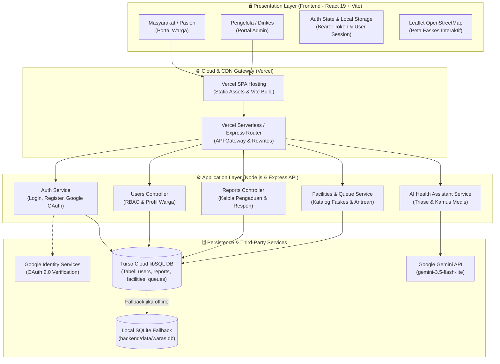
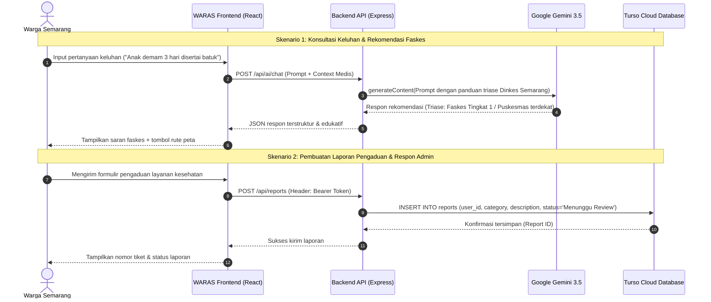

# 🏥 WARAS — Wadah Akses & Rujukan Aksi Sehat Kota Semarang

<div align="center">


<br/>

[](https://react.dev/)
[](https://vitejs.dev/)
[](https://tailwindcss.com/)
[](https://nodejs.org/)
[](https://turso.tech/)
[](https://ai.google.dev/)
[](https://vercel.com/)
[](LICENSE)

**Platform Civic-Tech Integrasi Layanan Kesehatan Terpadu, Pemantauan Antrean Faskes, dan Asisten Konsultasi Cerdas Berbasis AI untuk Warga Kota Semarang.**

[Fitur Utama](#-fitur-utama) • [Teknologi](#-teknologi-yang-digunakan) • [Arsitektur Sistem](#-diagram-arsitektur-dan-alur-data) • [Panduan Instalasi](#-panduan-instalasi-dan-konfigurasi) • [Akun Demo](#-akun-demonstrasi) • [Dokumentasi AI](#-dokumentasi-penggunaan-ai)

</div>

---

## 👥 Nama Tim & Daftar Anggota

**Nama Tim:** Tim WARAS Semarang (Civic Innovation Team)

| No | Nama Anggota | Role / Kontribusi Utama | GitHub Profile |
|:---:|:---|:---|:---|
| 1 | **Dafa Arkananta** | Frontend Lead & UX Specialist (Panduan Layanan, Modal & UI Interaktif) | [@DafaArkananta](https://github.com/DafaArkananta) |
| 2 | **Elok Chandra (naaelle1)** | Product Designer & Frontend Developer (Dashboard User & Integrasi Peta) | [@naaelle1](https://github.com/naaelle1) |
| 3 | **Ozzie (ozzie5555)** | Fullstack & Backend Architect (API Express, Turso Cloud, AI Gemini & RBAC) | [@ozzie5555](https://github.com/ozzie5555) |
| 4 | **Yusuf Analendra (Wisnu1101)** | Quality Assurance, Database & Data Researcher (Dataset Faskes & Istilah Medis) | [@Wisnu1101](https://github.com/Wisnu1101) |

---

## 📌 Informasi Proyek

* **Kategori Aplikasi:** Web Application (Responsive Web App — Mobile First & Desktop Friendly)
* **Nama Aplikasi:** **WARAS** (*Wadah Akses & Rujukan Aksi Sehat Semarang*)
* **Masalah yang Diangkat:**
  1. **Fragmentasi Informasi Faskes:** Warga sering kebingungan mencari faskes terdekat yang sesuai dengan jenis jaminan kesehatan (BPJS / UHC Kota Semarang) dan fasilitas darurat yang tersedia.
  2. **Salah Rujukan Faskes:** Banyak pasien langsung memadati IGD Rumah Sakit untuk keluhan non-darurat yang sebenarnya dapat ditangani secara optimal di Puskesmas atau Klinik Pratama.
  3. **Ketidakpastian Antrean & Alur Birokrasi:** Kurangnya visibilitas estimasi waktu antrean di faskes serta kebingungan mengenai syarat administratif berobat.
  4. **Kesenjangan Literasi Medis & Keluhan Layanan:** Pasien awam kesulitan memahami istilah diagnosis medis rumit dan membutuhkan saluran pengaduan layanan kesehatan yang transparan dan direspons cepat oleh pihak berwenang.
* **Deskripsi Solusi:**
  **WARAS** hadir sebagai jembatan *civic-tech* satu pintu yang mengintegrasikan direktori faskes interaktif berbasis peta geospatial (OpenStreetMap), pemantau antrean faskes real-time, panduan alur jaminan kesehatan (UHC Semarang & BPJS), saluran pelaporan & pengaduan publik yang terhubung langsung ke dashboard Dinas Kesehatan, serta asisten AI bertenaga Google Gemini untuk triase gejala awal, rekomendasi faskes, dan kamus istilah medis ramah awam.
* **Target Pengguna:**
  * **Masyarakat & Pasien:** Warga Kota Semarang, peserta BPJS Kesehatan, dan penerima UHC (Universal Health Coverage) Kota Semarang.
  * **Tenaga Medis & Petugas Faskes:** Pengelola data antrean dan ketersediaan layanan fasilitas kesehatan.
  * **Administrator / Dinas Kesehatan Kota Semarang:** Aparat pemangku kebijakan untuk memantau keluhan warga, tren layanan, dan agregasi statistik kesehatan kota.

---

## ✨ Fitur Utama yang Berhasil Diimplementasikan

### 1. 🗺️ Direktori Fasilitas Kesehatan & Peta Geospatial Interaktif
- Pemetaan visual Puskesmas, Rumah Sakit, dan Klinik Pratama di 16 kecamatan se-Kota Semarang menggunakan Leaflet & OpenStreetMap.
- Filter pencarian berdasarkan nama, kecamatan, kategori faskes, serta ketersediaan UGD 24 Jam dan akreditasi BPJS.
- Tombol aksi cepat: Navigasi rute Google Maps dan panggilan darurat Ambulans Hebat 119 / 112 Kota Semarang.

### 2. 🤖 Asisten Konsultasi Kesehatan Cerdas (WARAS AI)
- Didukung oleh model **Google Gemini 3.5 Flash Lite** dengan sistem prompt medis terstruktur.
- Memberikan panduan triase gejala awal, rekomendasi tingkat faskes yang tepat (kapan ke Puskesmas vs IGD RS), dan prosedur dokumen jaminan kesehatan.
- **Kamus Istilah Medis Awam:** Menerjemahkan istilah medis teknis (seperti *dyspepsia*, *hipertensi grade II*, *febris*) ke dalam bahasa sehari-hari yang mudah dipahami warga.
- Dilengkapi penafian medis resmi (*medical disclaimer*) untuk menjaga keamanan pengguna.

### 3. ⏱️ Pemantauan Antrean Fasilitas Kesehatan Real-Time
- Pelacakan nomor antrean yang sedang dilayani, sisa antrean, dan estimasi waktu tunggu pada poli aktif (Poli Umum, Poli Gigi, Poli KIA/Anak).
- Indikator status kepadatan layanan (*Lancar*, *Sedang*, *Padat*).

### 4. 📋 Panduan Alur Layanan & Jaminan Kesehatan (UHC & BPJS)
- Panduan terperinci alur rujukan berjenjang BPJS Kesehatan dan program UHC (Universal Health Coverage) Kota Semarang.
- Checklist interaktif dokumen persiapan berobat (KTP Kota Semarang, Kartu KIS/BPJS, Buku KIA, Surat Rujukan Faskes 1).
- Modul darurat terpadu: Panduan penanganan pertama dan akses panggilan darurat Ambulans Hebat 119.

### 5. 📢 Sistem Laporan & Pengaduan Warga Terpadu
- Formulir pelaporan kendala layanan kesehatan dengan kategori (Fasilitas, Obat/Farmasi, Sikap Petugas, Pungutan Liar).
- Pelacakan status laporan secara transparan (*Menunggu Review*, *Diproses*, *Selesai*).
- Jawaban & tanggapan resmi dari Admin Dinas Kesehatan yang langsung tersimpan di database dan dapat dibaca oleh pelapor.

### 6. 🛡️ Portal Administrator & Manajemen Terpadu (Admin Dashboard)
- **Ringkasan Statistik Real-Time:** Total pengguna, total faskes, laporan masuk, dan persentase penyelesaian masalah.
- **Kelola Pengguna (RBAC):** Pencarian user, filter status aktif/non-aktif, detail lengkap NIK & BPJS, serta modal edit data akun pengguna.
- **Kelola Pengaduan Masuk:** Penelaahan detail laporan, perubahan status investigasi, dan pengiriman tanggapan resmi dinas.
- **Keamanan Berlapis:** Akses halaman admin diproteksi middleware Bearer Token dan pengecekan role `admin`.

### 7. 🔐 Sistem Autentikasi Ganda & Mode Akses Cepat
- Registrasi mandiri warga dengan validasi NIK Kota Semarang (16 digit), No. BPJS, dan alamat.
- Autentikasi password aman menggunakan algoritma kriptografi `scrypt` dengan random salt 16-byte.
- Integrasi **Google OAuth 2.0 (Google Identity Services)** untuk login instan sekali klik.
- Fitur **Isi Cepat Akun Demo** untuk kemudahan pengujian juri dan evaluator.
- **Fallback Mode Offline:** UI tetap menyajikan data artikel, panduan, dan direktori faskes lokal yang informatif saat koneksi server terputus.

---

## 🛠️ Teknologi yang Digunakan

### Frontend
- **Framework & Core:** [](https://react.dev/) [](https://vitejs.dev/)
- **Styling & UI Components:** [](https://tailwindcss.com/)
- **Icons & Visuals:** [](https://lucide.dev/)
- **Maps & Geospatial:** [](https://leafletjs.com/) [](https://react-leaflet.js.org/)
- **Animation & Transitions:** [](https://www.framer.com/motion/)
- **Charts & Data Analytics:** [](https://recharts.org/)
- **Client Routing:** [](https://reactrouter.com/)

### Backend
- **Runtime & Web Framework:** [](https://nodejs.org/) [](https://expressjs.com/)
- **AI SDK:** [](https://www.npmjs.com/package/@google/genai)
- **Database Driver:** [](https://turso.tech/libsql)
- **Security & Utilities:** `crypto` (scrypt password hashing & HMAC-SHA256 tokens), `cors`, `dotenv`.

### Database & Infrastruktur Cloud
- **Database:** **Turso Cloud Database** (Distributed libSQL / SQLite Edge Database) dengan fallback otomatis ke SQLite lokal.
- **AI Engine:** **Google Gemini 3.5 Flash Lite** melalui Google AI Studio API.
- **Hosting & Deployment:**
  - **Frontend:** Vercel Hosting (Single Page Application with Rewrites).
  - **Backend:** Vercel Serverless Functions (`@vercel/node`) / Render Web Service Ready.

---

## 📐 Diagram Arsitektur dan Alur Data

### 1. Diagram Arsitektur Sistem



### 2. Diagram Alur Data Layanan Pengguna & AI



---

## 🚀 Panduan Instalasi dan Konfigurasi

### 1. Prasyarat Sistem
- **Node.js**: Versi `18.0.0` atau lebih baru (`node -v`)
- **NPM**: Versi `9.0.0` atau lebih baru (`npm -v`)
- **Git**: Terpasang di komputer Anda

### 2. Kloning Repository
```bash
git clone https://github.com/naaelle1/waras.git
cd waras
```

### 3. Konfigurasi Variabel Lingkungan (.env)

#### A. Frontend `.env` (di folder utama project)
Salin file `.env.example` menjadi `.env`:
```bash
cp .env.example .env
```
Isi konfigurasi berikut:
```env
# URL API Backend (Lokal)
VITE_API_BASE_URL=http://localhost:5000/api

# Google OAuth Client ID (untuk fitur Login with Google)
VITE_GOOGLE_CLIENT_ID=316051354828-c3driumks1hbvl5duh2b25uj70b9lve3.apps.googleusercontent.com
```

#### B. Backend `.env` (di dalam folder `backend/`)
Salin file `backend/.env.example` menjadi `backend/.env`:
```bash
cp backend/.env.example backend/.env
```
Isi konfigurasi berikut:
```env
PORT=5000
NODE_ENV=development
FRONTEND_URL=http://localhost:5173

# Google Gemini API Key
GEMINI_API_KEY=your_gemini_api_key_here
GEMINI_MODEL=gemini-3.5-flash-lite

# Database Turso (libSQL Cloud)
# Jika dikosongkan, backend otomatis beralih ke SQLite lokal (backend/data/waras.db)
TURSO_DATABASE_URL=libsql://waras-db-ozzie5555.aws-ap-northeast-1.turso.io
TURSO_AUTH_TOKEN=your_turso_auth_token_here

# Google OAuth 2.0
GOOGLE_CLIENT_ID=316051354828-c3driumks1hbvl5duh2b25uj70b9lve3.apps.googleusercontent.com
GOOGLE_CLIENT_SECRET=your_google_client_secret_here

# JWT Secret untuk otentikasi token
JWT_SECRET=waras-semarang-secret-key-2026
```

### 4. Instalasi Dependensi
Jalankan instalasi dependensi untuk Frontend dan Backend:
```bash
# 1. Install dependensi Frontend
npm install

# 2. Install dependensi Backend
npm run backend:install
```

### 5. Inisialisasi Database (Opsional jika menggunakan Turso baru / Lokal)
Untuk membuat struktur tabel dan mengisi data awal (dummy data faskes, antrean, artikel, dan akun admin default):
```bash
npm run db:init
npm run db:seed
```

### 6. Menjalankan Aplikasi di Lingkungan Lokal

Buka dua tab terminal terpisah:

**Terminal 1 — Jalankan Backend API:**
```bash
npm run dev:backend
# Backend aktif di http://localhost:5000
# Cek kesehatan API di: http://localhost:5000/api/health
```

**Terminal 2 — Jalankan Frontend Vite:**
```bash
npm run dev
# Frontend aktif di http://localhost:5173
```

---

## 🔑 Akun Demonstrasi

Aplikasi telah dilengkapi dengan akun demonstrasi siap pakai untuk memudahkan evaluasi:

### 1. Akun Administrator (Dinas Kesehatan / Pengelola Faskes)
* **Email / Identifier:** `admin` atau `admin@waras.semarangkota.go.id`
* **NIK:** `3374010101850001`
* **Password:** `admin123`
* **Hak Akses:**
  - Mengakses Dashboard Statistik Admin (`/admin/dashboard`).
  - Mengelola seluruh data pengguna terdaftar (Edit NIK, No. BPJS, Telepon, Status Akun) (`/admin/users`).
  - Meninjau pengaduan warga masuk, mengubah status penanganan, dan memberikan respon resmi dinas (`/admin/reports`).
  - Mengelola data antrean faskes dan artikel kesehatan.

> [!TIP]
> Pada halaman login, tersedia tombol **"Isi Cepat: Akun Admin"** untuk mengisi kredensial admin secara instan tanpa perlu mengetik manual.

### 2. Akun Pengguna Publik (Warga Semarang)
* **Email:** `budi.santoso@gmail.com`
* **NIK:** `3374021204900002`
* **Password:** `user123`
* **Hak Akses:**
  - Mengakses Dashboard Warga (`/user/dashboard`).
  - Melakukan konsultasi kesehatan dan kamus medis dengan Asisten AI (`/user/ai`).
  - Mencari direktori faskes terdekat berbasis peta interaktif (`/user/facilities`).
  - Mengajukan laporan pengaduan layanan kesehatan (`/user/reports`).
  - Mengakses panduan jaminan kesehatan dan ambulans darurat 119 (`/user/services`).
* **Metode Alternatif:** Dapat juga login instan menggunakan tombol **"Login with Google"** atau registrasi akun baru.

---

## 🧠 Dokumentasi Penggunaan AI

### 1. Model & Provider
* **Provider:** Google AI Studio / Google Cloud
* **Model yang Digunakan:** `gemini-3.5-flash-lite` (versi terbaru dengan latensi ultra-cepat dan penalaran efisien).
* **Library Integrasi:** `@google/genai` (SDK resmi Google).

### 2. Peran & Use Case AI dalam WARAS
1. **Triase Gejala Awal Ramah Warga:**
   Membantu masyarakat yang ragu atau cemas memahami urgensi keluhannya dan memberikan rekomendasi tingkat fasilitas kesehatan yang tepat (Puskesmas untuk rawat jalan, Klinik Pratama untuk tindakan dasar, atau IGD Rumah Sakit untuk kondisi darurat).
2. **Kamus Medis Bahasa Awam (Medical Translator):**
   Menerjemahkan diagnosa, resep, atau istilah kedokteran asing ke dalam bahasa Indonesia yang komunikatif dan mudah dimengerti pasien awam.
3. **Panduan Administrasi BPJS & UHC Semarang:**
   Memberikan informasi persyaratan dokumen berobat sesuai regulasi Dinas Kesehatan Kota Semarang.

### 3. Prompt Engineering & Keselamatan Medis (Safety Guidelines)
Sistem prompt WARAS AI dirancang dengan aturan keamanan ketat:
* **Penafian Medis Wajib:** AI selalu mengingatkan bahwa jawabannya bersifat edukatif dan bukan pengganti diagnosis resmi dokter.
* **Protokol Tanda Bahaya (Red Flags):** Jika pengguna mendeteksi gejala kritis (seperti nyeri dada menjalar, sesak napas berat, perdarahan hebat, atau hilang kesadaran), AI secara otomatis memprioritaskan rekomendasi panggilan darurat **Ambulans Hebat 119 Kota Semarang** atau segera menuju IGD terdekat.
* **Tidak Meresepkan Obat Keras:** AI tidak pernah memberikan dosis atau meresepkan obat keras antibiotik/psikotropika secara mandiri.

---

## 📜 Atribusi Template, Aset, Dataset, dan Pihak Ketiga

Pengembangan platform **WARAS** menggunakan berbagai sumber daya terbuka berkualitas tinggi:

1. **Peta & Data Geospasial:**
   - **Leaflet.js:** Pustaka peta interaktif open-source ([Leaflet](https://leafletjs.com/)).
   - **OpenStreetMap:** Data peta dasar dan kontributor pemetaan terbuka ([OSM](https://www.openstreetmap.org/)).
2. **Ikonografi & Ilustrasi:**
   - **Lucide Icons:** Kumpulan ikon SVG konsisten dan berlisensi ISC ([Lucide React](https://lucide.dev/)).
   - **Transhumans Illustrations (Pablo Stanley):** Ilustrasi karakter ramah pada antarmuka pengguna ([Transhumans](https://www.transhumans.xyz/)).
3. **Tipografi:**
   - **Poppins & Inter:** Google Fonts berlisensi Open Font License (OFL).
4. **Data Rujukan Kesehatan:**
   - Referensi daftar nama Puskesmas, Rumah Sakit, dan Call Center Kesehatan diadaptasi dari portal data terbuka **Dinas Kesehatan Kota Semarang** dan inisiatif **Satu Data Kota Semarang**.
5. **Pustaka Open Source:**
   - Komunitas open-source pengembang React, Vite, Tailwind CSS, Express, dan Turso LibSQL.

---

<div align="center">

Dibuat dengan ❤️ untuk kemajuan pelayanan kesehatan masyarakat **Kota Semarang**.

**WARAS — Sehat Wargane, Gampang Rujukane!**

</div>
